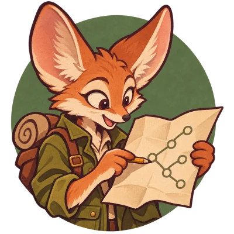
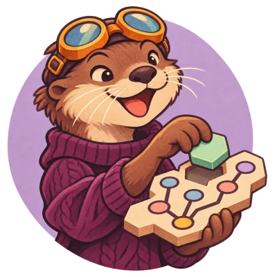

# Proof2Game

**Turn a math manuscript into a game you can play.**

Give Proof2Game a paper, a draft, or your math notes. A team of Codex agents reviews the argument and builds a bilingual browser game where you can explore the proof one step at a time.

[Quick start](#quick-start) · [Meet the team](#meet-the-team) · [Play a shared game](#play-a-shared-game)

## Quick start

**Copy the entire block into ChatGPT Work in your browser, or into ChatGPT Desktop or Codex on your Mac.**

```text
Set up and run Proof2Game from this repository.
https://github.com/zhenyao-sun/Proof2Game

Follow Manual setup in the repository README and load skills/proof2game/SKILL.md.
Ask for my project folder and math manuscript or notes if I haven't provided them.
Preserve my original and run the guided workflow through delivery. Track progress in the project ledger.
```

You can attach a LaTeX file, Markdown notes, or a PDF, or paste an arXiv link. An unfinished draft is enough to get started.

## What you get

| Bring | Take away |
| --- | --- |
| **Your unpublished work** | A shareable game and a complete English paper in PDF and LaTeX, built from the same reviewed script. |
| **A public paper** | A game that follows the edition you chose, plus a generic PDF referee report based on the original paper and the final reviewed game script. |

Proof2Game keeps your original and builds a separate English game script. Independent Codex reviewers check the argument and the cited results. For public papers, a separate reviewer checks the route against the exact edition you supplied. For unpublished work, the team explores whether the proof can be made simpler.

## What it's like to play

- **Follow the proof map.** Statements, lemmas, and proofs become levels. Unlock the next part as you go.
- **Get help when you want it.** Ask the tutor to work through a step with you, or switch to open chat. Play in English or Chinese.
- **See the source.** Follow citations to the DOI or official source and use the displayed locator.
- **Pick up where you left off.** Save progress locally, undo a step, or export a save to continue the same game on another Mac.

## Meet the team

One Codex session coordinates the work. Each specialist takes a different part of the journey from manuscript to game.

<table>
  <tr>
    <td width="50%" valign="top">
      <p align="center"></p>
      <strong>Explorer</strong><br>
      <em>“What does this theorem depend on?”</em><br>
      Maps the lemmas behind the main results and looks for simpler ways to prove them.
    </td>
    <td width="50%" valign="top">
      <p align="center"></p>
      <strong>Reviewer</strong><br>
      <em>“Does this step follow?”</em><br>
      Independently checks definitions, assumptions, deductions, and what each citation supports.
    </td>
  </tr>
  <tr>
    <td width="50%" valign="top">
      <p align="center"></p>
      <strong>Fixer</strong><br>
      <em>“Let's see where the argument breaks.”</em><br>
      Checks reported problems, repairs gaps where possible, and sends the revisions back for a fresh review.
    </td>
    <td width="50%" valign="top">
      <p align="center"></p>
      <strong>Game Developer</strong><br>
      <em>“Try following that argument on a map.”</em><br>
      Builds an unlockable, bilingual game from the reviewed script and links to the cited sources.
    </td>
  </tr>
  <tr>
    <td width="50%" valign="top">
      <p align="center"></p>
      <strong>Writer</strong><br>
      <em>“Let's get the argument onto the page.”</em><br>
      Writes an English paper for unpublished work or a referee report comparing a public paper with the final reviewed game script.
    </td>
    <td width="50%" valign="top">
      <p align="center"></p>
      <strong>Tutor</strong><br>
      <em>“Where would you like to slow down?”</em><br>
      Walks through the proof with you and answers questions as you play.
    </td>
  </tr>
</table>

[Agent responsibilities](skills/proof2game/references/workers.md) · [Default model settings](skills/proof2game/references/roles.json)

## Play a shared game

Open a shared GitHub Pages link and copy its prompt into Codex on your Mac.
The launcher opens the local game in your default browser and prints its
address, which you can reuse from another tab or browser on the same Mac.
You need Node.js 20 or later and your own Codex login.

Authors can [export and publish a game directory to GitHub Pages](skills/proof2game/references/game.md#publish-the-website)
from the approved bilingual snapshot.

## Examples

- [Local smoothing for the Euclidean wave equation](https://zhenyao-sun.github.io/Proof2Game-OpenAI-Local-Smoothing/) — based on the OpenAI manuscript dated October 25, 2026.

## Manual setup

Author in the Linux workspace of ChatGPT Work, or use macOS with ChatGPT Desktop or Codex. Guided verification requires terminal access and independent agent sessions. The project ledger tracks progress and completion. A Codex Goal is optional. In Work, attach the manuscript or provide an accessible workspace project path. Proof2Game uses Git and Python 3.11 or later. Use Poppler for PDF intake, TeX Live or MacTeX for compilation, and Node.js 22 or later for authoring checks. Players can run an exported game with Node.js 20 or later. The PDF navigation check uses `pdftotext` or `pypdf`.

If you already have a verified release checkout, use it and let Proof2Game check for updates. For a fresh setup, run:

```sh
proof2game_version=v0.1.29
case "$(uname -s)" in
  Darwin) proof2game_releases="$HOME/Library/Application Support/Proof2Game/releases" ;;
  Linux)
    case "${XDG_DATA_HOME:-}" in
      /*) proof2game_releases="$XDG_DATA_HOME/proof2game/releases" ;;
      *) proof2game_releases="$HOME/.local/share/proof2game/releases" ;;
    esac
    ;;
esac
proof2game_checkout="$proof2game_releases/$proof2game_version"
mkdir -p "$proof2game_releases"
git clone --depth 1 --branch "$proof2game_version" https://github.com/zhenyao-sun/Proof2Game.git "$proof2game_checkout"
python3 "$proof2game_checkout/skills/proof2game/scripts/release.py" verify
```

Linux authoring requires a release that includes Work support. If the pinned release predates that support, use macOS for that release. Load the skill at the `entrypoint` returned by the verifier. You can run the full guided workflow, ingest a reference PDF, verify an existing game script, or request a refactor. [Skill documentation](skills/proof2game/SKILL.md)

## License

Proof2Game is released under the [MIT License](LICENSE). The bundled KaTeX code uses the [MIT License](skills/proof2game/assets/game-runtime/vendor/LICENSE-KaTeX.txt), and its fonts use the [SIL Open Font License](skills/proof2game/assets/game-runtime/vendor/fonts/OFL.txt).
