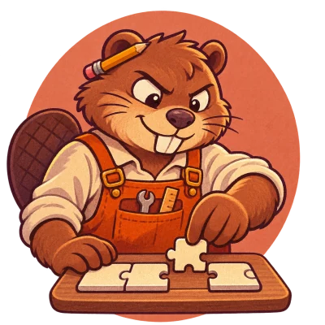

# Proof2Game

**Turn a math manuscript into a game you can play.**

Give Proof2Game a paper, a draft, or your math notes. A team of Codex agents reviews the argument and builds a bilingual browser game where you can explore the proof one step at a time.

[Quick start](#quick-start) · [Meet the team](#meet-the-team) · [Play a shared game](#play-a-shared-game)

## Quick start

**Copy the entire block into ChatGPT Desktop or Codex on your Mac.**

```text
Set up and run Proof2Game from this repository.
https://github.com/zhenyao-sun/Proof2Game

Follow Manual setup in the repository README and load skills/proof2game/SKILL.md.
Ask for my project folder and math manuscript or notes if I haven't provided them.
Preserve my original, create or resume a Codex Goal, and run the guided workflow through delivery.
```

You can attach a LaTeX file, Markdown notes, or a PDF, or paste an arXiv link. An unfinished draft is enough to get started.

## What you get

| Bring | Take away |
| --- | --- |
| **Your unpublished work** | A shareable game and a complete English paper in PDF and LaTeX, built from the same reviewed script. |
| **A public paper** | A game that follows the edition you chose. If review confirms a substantive flaw in the original, you also receive a PDF referee report. |

Proof2Game keeps your original and builds a separate English game script. Independent Codex reviewers check the argument and the cited results. For public papers, a separate reviewer checks the route against the exact edition you supplied. For unpublished work, the team explores whether the proof can be made simpler.

## What it's like to play

- **Follow the proof map.** Statements, lemmas, and proofs become levels. Unlock the next part as you go.
- **Get help when you want it.** Ask the tutor to work through a step with you, or switch to open chat. Play in English or Chinese.
- **See the source.** Open the cited PDFs from inside the game and jump to the relevant pages.
- **Pick up where you left off.** Save progress locally, undo a step, or export a save to continue the same game on another Mac.

## Meet the team

One Codex session coordinates the work. Each specialist takes a different part of the journey from manuscript to game.

<table>
  <tr>
    <td width="50%" valign="top">
      <p align="center"></p>
      <strong>Explorer</strong><br>
      <em>“What does this theorem depend on?”</em><br>
      Maps the lemmas behind the main results and looks for simpler ways to prove them.
    </td>
    <td width="50%" valign="top">
      <p align="center"></p>
      <strong>Reviewer</strong><br>
      <em>“Does this step follow?”</em><br>
      Independently checks definitions, assumptions, deductions, and what each citation supports.
    </td>
  </tr>
  <tr>
    <td width="50%" valign="top">
      <p align="center"></p>
      <strong>Fixer</strong><br>
      <em>“Let's see where the argument breaks.”</em><br>
      Checks reported problems, repairs gaps where possible, and sends the revisions back for a fresh review.
    </td>
    <td width="50%" valign="top">
      <p align="center"></p>
      <strong>Game Developer</strong><br>
      <em>“Try following that argument on a map.”</em><br>
      Builds an unlockable, bilingual game from the reviewed script and bundles the cited PDFs.
    </td>
  </tr>
  <tr>
    <td width="50%" valign="top">
      <p align="center"></p>
      <strong>Writer</strong><br>
      <em>“Let's get the argument onto the page.”</em><br>
      Writes an English paper for unpublished work or documents confirmed flaws in a public paper.
    </td>
    <td width="50%" valign="top">
      <p align="center"></p>
      <strong>Tutor</strong><br>
      <em>“Where would you like to slow down?”</em><br>
      Walks through the proof with you and answers questions as you play.
    </td>
  </tr>
</table>

[Agent responsibilities](skills/proof2game/references/workers.md) · [Default model settings](skills/proof2game/references/roles.json)

## Play a shared game

Give the game ZIP to ChatGPT Desktop or Codex and ask it to launch the game on your Mac. It will open in your browser. The game and saves live on your computer. Tutor replies use your own Codex login and an internet connection.

## Manual setup

Use macOS with ChatGPT Desktop or Codex, local terminal access, Codex Goals, and independent agent sessions. Proof2Game uses Git and Python 3.11 or later. Use Poppler for PDF intake, TeX Live or MacTeX for compilation, and Node.js 22 or later for authoring checks. Players can run an exported game with Node.js 20 or later. The PDF navigation check uses `pdftotext` or `pypdf`.

If you already have a verified release checkout, use it and let Proof2Game check for updates. For a fresh setup, run:

```sh
proof2game_releases="$HOME/Library/Application Support/Proof2Game/releases"
mkdir -p "$proof2game_releases"
git clone --depth 1 --branch v0.1.6 https://github.com/zhenyao-sun/Proof2Game.git "$proof2game_releases/v0.1.6"
python3 "$proof2game_releases/v0.1.6/skills/proof2game/scripts/release.py" verify
```

Load the skill at the `entrypoint` returned by the verifier. You can run the full guided workflow, ingest a reference PDF, verify an existing game script, or request a refactor. [Skill documentation](skills/proof2game/SKILL.md)

## License

Proof2Game is released under the [MIT License](LICENSE). The bundled KaTeX code uses the [MIT License](skills/proof2game/assets/game-runtime/vendor/LICENSE-KaTeX.txt), and its fonts use the [SIL Open Font License](skills/proof2game/assets/game-runtime/vendor/fonts/OFL.txt).
